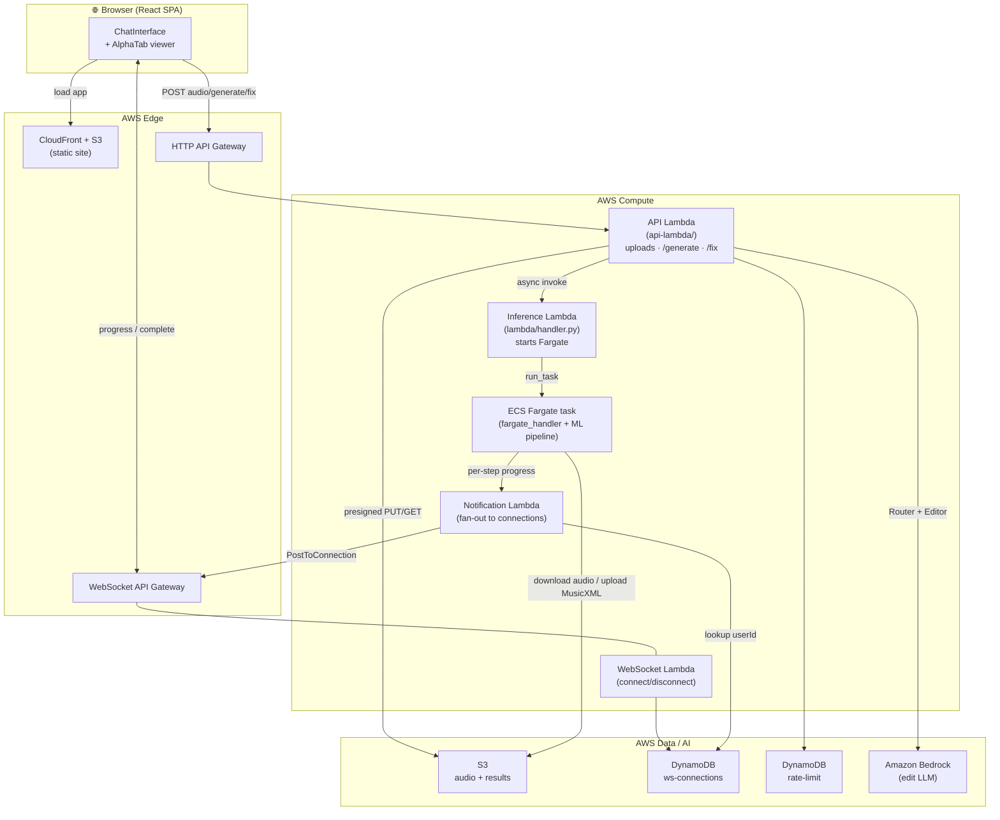
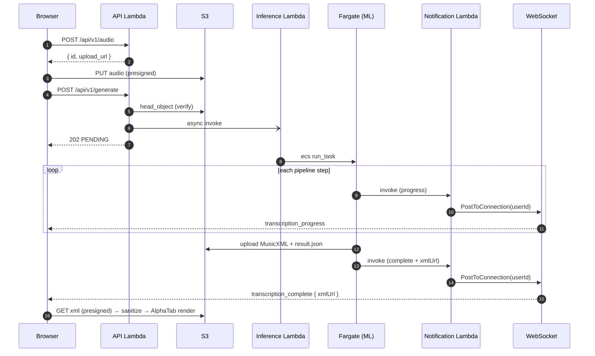
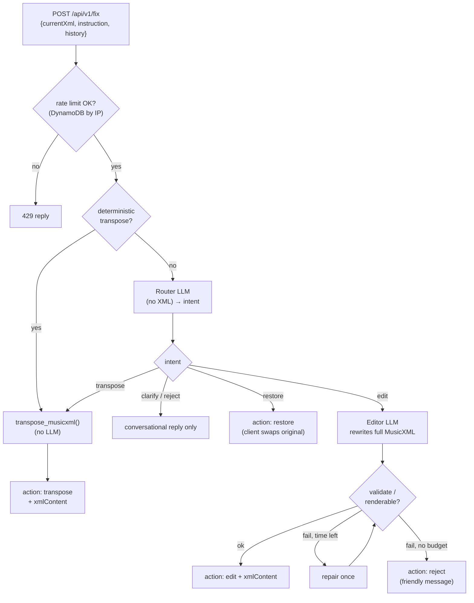
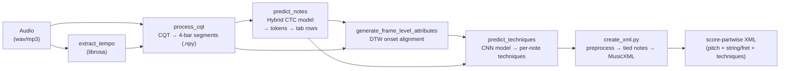

# Solola (`eg-solo-app`) — Architecture & Codebase Guide

> **Solola** is a web application that transcribes **electric guitar solo
> audio** into editable guitar **notation + tablature**. A user uploads an
> audio clip (or, eventually, a YouTube link); a deep-learning pipeline
> predicts notes and playing techniques; the result is rendered as an
> interactive score the user can play back, zoom, and **edit conversationally
> with an LLM** ("transpose up 2 semitones", "make the 3rd note a bend", "revert
> to the original").

This document describes the **current state** of the codebase under
`eg-solo-app/`. It is hand-derived from the source, not generated boilerplate.

---

## 1. High-level concept

The product is an AI **chat interface** for guitar transcription. There are two
distinct AI systems involved, and it is important not to confuse them:

| System | What it does | Where it runs | "Model" |
|--------|--------------|---------------|---------|
| **Transcription pipeline** | Audio → MusicXML score (the core ML research product) | ECS Fargate container | Two PyTorch Lightning checkpoints (note model + technique model) |
| **Edit assistant** | Natural-language edit of an existing score | API Lambda | Amazon Bedrock LLM (`openai.gpt-oss-20b` by default) |

The whole thing is a **serverless AWS application** fronted by a React SPA. The
slowest, heaviest work (ML inference) runs in a Fargate task that can take
several minutes; progress is streamed back to the browser over a **WebSocket**.
Fast, interactive work (presigned uploads, LLM edits, deterministic transposes)
runs in short-lived **Lambda** functions behind an HTTP API Gateway.

A key UX constraint, captured in the design docs: transcription takes roughly
**7–8× the clip length**, and output is **beta-quality / imperfect but
fixable**. Much of the frontend and the edit engine exists to set those
expectations and to let users repair the result.

---

### System architecture (Mermaid)



## 2. Repository layout

```
eg-solo-app/
├── web/                  React + TypeScript + Vite SPA (the chat UI)
├── api-lambda/           HTTP API Lambda: uploads, generation trigger, LLM /fix
├── lambda/               Inference Lambda + the Fargate ML pipeline + MusicXML gen
├── terraform/            All AWS infrastructure as code
│   ├── lambda-websocket/     Node.js: WebSocket $connect/$disconnect handler
│   └── lambda-notification/  Node.js: pushes progress messages to connections
├── server/               Local-dev FastAPI stub (not deployed)
├── docs/superpowers/     Specs & plans for the LLM-UX roadmap
├── deploy-frontend.sh    Build web → sync to S3 → invalidate CloudFront
├── deploy-api-lambda.sh  Build api-lambda Docker image → push to ECR → update fn
└── test-events/          Sample Lambda invocation payloads
```

---

## 3. End-to-end flows

### 3.1 Transcription (audio upload → score)

```
Browser (ChatInterface)
   │ 1. POST /api/v1/audio  {source_type:"local", source:{filename,content_type}}
   ▼
API Lambda (handler.py) ──► returns { id, name, upload_url (S3 presigned PUT) }
   │ 2. PUT file → S3  (uploads/<uuid>.<ext>)
   │ 3. POST /api/v1/generate  {file_id, filename, user_id, source_type}
   ▼
API Lambda verifies object exists, async-invokes ──►
   Inference Lambda (lambda/handler.py)
       └─ ecs run_task → Fargate container (fargate_handler.py)
              ├─ download audio from S3
              ├─ run ML pipeline (inference.py + create_xml.py) → MusicXML
              ├─ upload results to S3 (inference_results/<task_id>/...)
              └─ at each step: invoke notification Lambda  ──► WebSocket ──► Browser
   ▼
Browser receives "transcription_complete" {xmlUrl} over WebSocket,
fetches the presigned XML, sanitizes it, and renders it with AlphaTab.
```

The browser **never polls**. After kicking off generation it just waits for
WebSocket messages (`transcription_progress`, `transcription_complete`,
`error`). The `check_status_handler` in `lambda/handler.py` is an alternative
S3-polling path that the current frontend does not use.



### 3.2 Conversational edit (existing score → edited score)

Once a score is rendered, any further text message routes to `POST
/api/v1/fix`. The server runs a **Router → Editor** pipeline (section 5).

```
Browser (handleAiFix)  POST /api/v1/fix {currentXml, instruction, history}
   ▼
API Lambda /fix route:
   1. rate-limit check (DynamoDB, by source IP)
   2. FAST PATH: deterministic transpose? → transpose_musicxml(), return (no LLM)
   3. ROUTER (LLM, no XML): classify intent → edit | transpose | restore | clarify | reject
   4. dispatch:
        clarify/reject → conversational reply only
        restore        → tell client to swap back to stored original
        transpose      → deterministic transpose_musicxml()
        edit           → EDITOR (LLM rewrites whole MusicXML) + validate/repair
   ▼
Browser applies action: replace rendered XML, or show reply, or restore client-side.
```

`restore`/revert intents are also caught **client-side** before any network call
(`isRestoreIntent` in `ChatInterface.tsx`) — the original transcription is kept
in `originalXmlRef` for the session and swapped back instantly.



---

## 4. The frontend (`web/`)

**Stack:** React 18, TypeScript, Vite 6, `@coderline/alphatab` (notation/tab
rendering + playback), `lucide-react` (icons). No state-management library, no
test framework, no router beyond a single page.

**Entry:** `src/main.tsx` → `App.tsx` → `<ChatInterface />`. The entire app is
essentially one big component plus two custom hooks.

### Key files

- **`components/chat/ChatInterface.tsx`** — the heart of the app (~680 lines).
  Owns the message list, processing state, and all the orchestration logic:
  - `handleSend` decides what a user message means: file upload → transcription;
    YouTube URL → YouTube flow; restore intent → client-side swap; otherwise →
    LLM edit (`handleAiFix`); empty/no-score → a prompt to upload.
  - `handleUploadAndGenerate` / `handleYouTubeTranscription` — the 3-step
    presigned-upload + generate calls.
  - `handleAiFix` — calls `/api/v1/fix`, interprets the returned `action`
    (`edit`/`transpose`/`restore`/`clarify`/`reject`) and updates the score or
    just replies.
  - `sanitizeXml` — strips LLM reasoning blocks, fixes `A#`→`<step>A</step>
    <alter>1</alter>` pitch issues, and extracts only the
    `<score-partwise>…</score-partwise>` body. **Important defensive layer** —
    both transcription results and LLM edits pass through it.
  - Refs hold session state: `latestXmlRef` (current score), `originalXmlRef`
    (first transcription, for restore).
- **`hooks/useWebSocket.ts`** — wraps a browser `WebSocket` with auto-connect,
  auto-reconnect (max 5 attempts, linear backoff), and exposes
  `{isConnected, lastMessage, sendMessage}`. Connects with `?userId=…` so the
  backend can route notifications to this user's connection(s).
- **`hooks/useAlphaTab.ts`** — wraps the AlphaTab API: lazy-imports the library,
  loads MusicXML bytes, configures the HTML5 renderer + soundfont player
  (`/soundfont/sonivox.sf3`, `/font/` Bravura music font), and exposes
  play/pause, stop, zoom, layout (page/horizontal), print. Forces both standard
  notation **and** tablature staves on.
- **`components/GuitarTabViewer.tsx`** — the score viewer (toolbar +
  AlphaTab mount points), driven by `useAlphaTab`.
- **`components/chat/`** — `ChatMessage` (bubble; mounts the viewer for the
  latest complete-with-XML message only), `ChatInput`, `HowItWorks`
  (collapsible onboarding accordion — see `docs/.../app-orientation-design.md`).
- **`types/chat.ts`** — `ChatMessage` shape (role, content, status, progress,
  statusText, xmlContent, file).

### Identity & config

- A per-tab **`userId`** is generated and stored in `sessionStorage`; it ties
  the WebSocket connection to the transcription task so progress is delivered.
- Endpoints come from Vite env (`.env.development` / `.env.production`):
  `VITE_API_URL`, `VITE_WEBSOCKET_URL`, `VITE_FIX_API_URL`, with hard-coded
  production fallbacks (`*.execute-api.us-east-1.amazonaws.com`).

---

## 5. The edit engine (`api-lambda/`) — the "smarter edit assistant"

This is the most carefully engineered backend module. Its design goal (see
`docs/superpowers/specs/2026-06-18-smarter-edit-assistant-design.md`) is
**reliability within a strict ~30s API Gateway timeout** and **clean handling of
out-of-scope requests**, while running on a small/cheap Bedrock model.

It is a **two-stage LLM pipeline plus deterministic fast paths**:

| File | Role |
|------|------|
| `handler.py` | API Gateway router; CORS; rate limiting; presigned URLs; `/generate`; orchestrates `/fix`. |
| `edit_router.py` | **Router** — cheap LLM call with *no MusicXML*, just history + instruction. Classifies into `edit / transpose / restore / clarify / reject` and writes a friendly reply. Safe fallback to `edit` on any parse failure. |
| `edit_executor.py` | **Editor** — expensive LLM call that rewrites the *entire* MusicXML, then validates and **repairs once** if there's time budget left. |
| `transpose.py` | **Deterministic transpose** (no LLM): regex-walks `<note>` blocks, recomputes pitch + guitar string/fret from MIDI. |
| `musicxml_validate.py` | Sanitizes raw LLM output and validates structure + a soft note-count plausibility band; `count_notes`. |
| `edit_response.py` | Builds the uniform `/fix` response body `{action, reply, xmlContent?, intent?}`. |

### Why this shape

- **Transpose is the killer fast path.** It's deterministic, instant, and never
  times out, so the handler tries `parse_transpose_semitones(instruction)`
  *before even calling the Router*. Bedrock client read timeout is capped at 25s
  and the Editor budgets wall-clock so a slow rewrite **aborts gracefully** (a
  friendly "try a smaller change") instead of returning a raw 503/gateway
  timeout.
- **The Router sees no XML**, keeping it cheap and token-safe, and lets the
  system reject out-of-scope requests ("add a drum track", "change the lyrics")
  with a helpful message rather than mangling the score.
- **The Editor is best-effort:** if the rewrite is well-formed and renderable
  but only trips the soft note-count heuristic, it's still returned — a real
  edit beats a dead end.

### Guardrails

- **Rate limiting** in DynamoDB (`solola-rate-limit`), keyed by source IP:
  default 20/hour, 100/day. Fails *open* if the check itself errors.
- Input caps: `MAX_XML_SIZE` 500 KB, `MAX_INSTRUCTION_SIZE` 1000 chars.
- CORS origin is reflected only for an allow-list (`solola.net`,
  `www.solola.net`, `localhost:5173`).

This module is the only part of the repo with **unit tests**
(`api-lambda/tests/`, pytest): `test_edit_router`, `test_edit_executor`,
`test_edit_response`, `test_musicxml_validate`, `test_transpose`.

---

## 6. The ML transcription pipeline (`lambda/`)

Two roles live here:

1. **`handler.py`** — a thin Lambda that just **starts a Fargate task**
   (`ecs run_task`) with the right env vars (audio key / YouTube URL, task id,
   user id, source type). It does the ML's S3 validation but **no ML itself**.
   `check_status_handler` offers optional S3-result polling.
2. **`fargate_handler.py`** — the container entry point that **runs the actual
   pipeline** and pushes WebSocket progress notifications at each step.

### The model pipeline (`inference.py` + `create_xml.py`)

The research core. Conceptually: **audio → CQT spectrogram → note tokens →
techniques → MusicXML**.



1. **Tempo** — `extract_tempo` via `librosa.beat.beat_track`.
2. **CQT segmentation** (`process_cqt`) — resample to 22050 Hz, compute a
   Constant-Q Transform (24 bins/octave, 192 bins, hop 256), and slice into
   **4-bar segments** aligned to the detected tempo. Saves `.npy` per segment +
   segment metadata.
3. **Note prediction** (`predict_notes`) — a **Hybrid CTC** Lightning model
   (`HybridCTCLitModule`) batches all segments, runs one inference, and a
   tokenizer converts CTC tokens → tablature rows. Output per note is a tuple:
   `[start, duration, pitch, string, fret, technique]`.
4. **Frame-level attributes** (`generate_frame_level_attributes`) — aligns
   note-level onsets to audio frames using **DTW** over a hybrid cost
   (position + onset-strength), to feed the technique model.
5. **Technique prediction** (`predict_techniques`) — a **CNN** Lightning model
   (`CNNLitModule`) predicts per-note guitar techniques (bend, slide,
   hammer-on, pull-off, vibrato, palm-mute, etc.), then maps tatum-level
   predictions to note-level.
6. **MusicXML generation** (`create_xml.py`) — the predicted note list
   (`[start, duration, pitch, string, fret, technique]`, with a **bar length of
   48 subdivisions**) is run through `preprocess_input` → `process_tied_notes`
   → `create_musicxml`, handling tied notes and practical rhythmic
   subdivisions, and emitting standard MusicXML with `<pitch>` + guitar
   `<string>`/`<fret>` + technique notations.

Model code lives in `lambda/src/`:
`models/hybrid_ctc_lit_module.py`, `models/cnn_lit_module.py`,
`models/network/{hybrid_ctc_net,cnn_net}.py`, `models/decoder/decoder.py`,
`tokenizer/tokenizer.py`. Weights are the checkpoints
`solo_trans_epoch_099.ckpt` (notes) and `solo_tech_epoch_099.ckpt`
(techniques), baked into the container image.

### YouTube support

`download_youtube_audio` (in `fargate_handler.py`) uses `yt-dlp` with **five
fallback player-client strategies** to dodge YouTube's server-IP bot detection,
then converts to MP3 with ffmpeg. It frequently fails from cloud IPs — which is
exactly why the **UI now markets YouTube as "coming soon"** and only advertises
file upload. The backend path still works when YouTube cooperates.

---

## 7. Infrastructure (`terraform/`)

All AWS resources are defined here (region `us-east-1`, account `0507…443`,
profile `solola-admin`). Notable files:

| File | Resources |
|------|-----------|
| `api-gateway.tf` | HTTP API for `/api/v1/audio`, `/generate`, `/fix`. |
| `websocket-api.tf` | WebSocket API (`$connect`/`$disconnect`/`$default`). |
| `lambda.tf` | The inference + API Lambdas (container images from ECR). |
| `fargate.tf` | ECS cluster + task definition for the GPU/CPU ML container. |
| `ecr.tf` | Container registries (`eg-solo-api`, inference image). |
| `s3.tf` | Audio + results bucket, and the frontend static-site bucket. |
| `cloudfront.tf` | CDN in front of the frontend bucket. |
| `route53-acm.tf` | DNS + TLS cert for `solola.net`. |
| `dynamodb-rate-limit.tf` | `solola-rate-limit` table (edit throttling). |
| `vpc.tf` | Networking for Fargate (subnets, security groups, public IP). |
| `lambda-websocket/` | Node Lambda: stores/removes `{connectionId, userId}` in DynamoDB (`eg-solo-websocket-connections`, 24h TTL). |
| `lambda-notification/` | Node Lambda (`eg-solo-websocket-notification`): given `{userId, type, data}`, looks up the user's live connections via the `UserIdIndex` and `PostToConnection`s the message; prunes stale (410) connections. |

**WebSocket fan-out model:** the Fargate task can't talk to browsers directly,
so it invokes the notification Lambda, which looks up all connections for that
`userId` and pushes the message through the API Gateway management API. See
`terraform/WEBSOCKET_SETUP.md`.

### Deployment

- **Frontend:** `deploy-frontend.sh` reads Terraform outputs, writes
  `.env.production` with the live API endpoint, `npm run build`, syncs `dist/`
  to S3 (immutable cache for assets, no-cache for HTML), invalidates CloudFront.
- **API Lambda:** `deploy-api-lambda.sh` builds the `linux/amd64` Docker image,
  pushes to ECR, updates the function. (`lambda/build_and_push.sh` does the same
  for the inference image.)
- **Infra:** standard `terraform init/plan/apply` (see `terraform/README.md`).

---

## 8. Local development (`server/`)

`server/main.py` is a small **FastAPI stub** used only for local dev — it
implements `POST /api/v1/audio` (presigned URL / YouTube info via `pytubefix`)
against a local AWS profile, mirroring the deployed API Lambda's audio route. It
does **not** implement `/generate` or `/fix` and is not part of the deployed
stack. `environment.yml` is its conda env.

For the frontend, `npm run dev` (in `web/`) runs Vite against the deployed AWS
endpoints by default.

---

## 9. Roadmap context

`docs/superpowers/specs/` and `docs/superpowers/plans/` track a five-piece
LLM-UX roadmap, each with its own spec → plan → implementation cycle:

- **⓪ App orientation** — the collapsible "How it works" onboarding (shipped).
- **① Robust edit engine** — the Router→Editor `/fix` pipeline replacing naive
  full-MusicXML LLM rewrites (shipped; this is section 5).
- **② In-context discoverability & graceful failure** — depends on ①.
- **③ Pre-transcription parameters** — let users supply tempo/tuning/key before
  generation to improve accuracy.
- **④ Export & playback** — PDF / Guitar Pro / MIDI export, loop / slow-down.

---

## 10. Quick reference

**Public surface (HTTP API):**
- `POST /api/v1/audio` → presigned S3 upload URL (or YouTube video info).
- `POST /api/v1/generate` → kick off transcription (async; 202).
- `POST /api/v1/fix` → conversational edit (Router→Editor).
- `WSS …/prod?userId=…` → progress + completion notifications.

**Per-note data tuple (pipeline internal):**
`[start, duration, pitch, string, fret, technique]`, bar length = 48 subdivisions.

**Two models, don't confuse them:** PyTorch checkpoints (transcription, on
Fargate) vs. Bedrock LLM (editing, in Lambda).

**Where the tests are:** `api-lambda/tests/` (pytest) — the edit engine only.
The web app and ML pipeline have no automated test suite.
</content>
